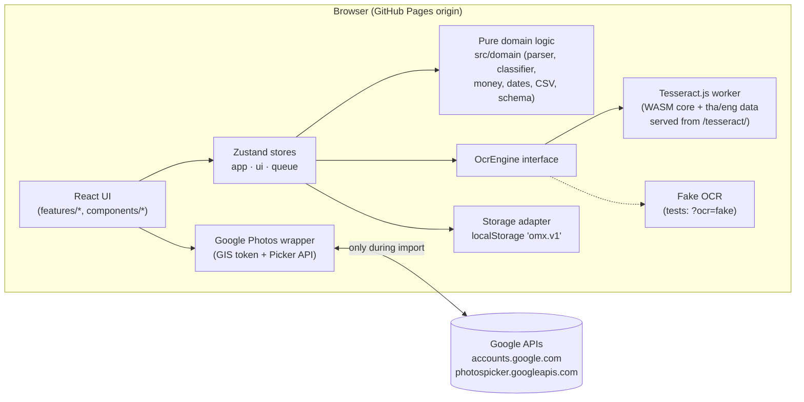

# Spendy Money

> **TH:** บันทึกรายรับ–รายจ่ายอัตโนมัติจากรูปสลิป — อ่านสลิปด้วย OCR **ในเบราว์เซอร์** แยกรายรับ/รายจ่าย ดึงจำนวนเงิน/วันที่ และจัดหมวดหมู่ให้ ตรวจแก้ก่อนบันทึก ข้อมูลอยู่ในเครื่องคุณเท่านั้น
>
> **EN:** Record income and expenses automatically from slip images. Slips are read with OCR **inside your browser**; type, amount, date and category are detected for you to review before saving. Your data never leaves your device.

**Live:** https://jaijimjim.github.io/spendy-project/ · MVP_0001 · Sprint 1

---

## สารบัญ / Contents
1. [Features](#features)
2. [Architecture](#architecture)
3. [Folder structure](#folder-structure)
4. [Local setup](#local-setup)
5. [Scripts](#scripts)
6. [Configuration (env)](#configuration-env)
7. [Google Photos setup (OAuth Client ID + Picker API)](#google-photos-setup)
8. [Deploy to GitHub Pages](#deploy-to-github-pages)
9. [Testing](#testing)
10. [Privacy & security](#privacy--security)
11. [Contributing](#contributing)

---

## Features

| TH | EN |
|---|---|
| อัปโหลดสลิป (JPG/PNG/WebP ≤ 10 MB, ครั้งละ ≤ 20 รูป) ลากวางได้บนเดสก์ท็อป | Upload slips (JPG/PNG/WebP ≤ 10 MB, ≤ 20 per batch), drag & drop on desktop |
| นำเข้าจาก Google Photos ผ่าน Photos Picker API | Import from Google Photos via the Photos Picker API |
| OCR ภาษาไทย+อังกฤษด้วย Tesseract.js ในเบราว์เซอร์ (ไฟล์โมเดล host เอง) | Thai+English OCR with Tesseract.js in the browser (self-hosted model files) |
| แยกประเภท (สลิปเงินเดือน = รายรับ, โอน/ชำระสำเร็จ = รายจ่าย, ได้รับเงิน = รายรับ), จำนวนเงิน, วันที่ (พ.ศ./ค.ศ.), ผู้รับ, ธนาคาร, หมวดหมู่ 12 หมวด + ระดับความมั่นใจ | Detects type (payslip → income, transfer/payment → expense, received → income), amount, date (BE/CE), payee, bank, 12 categories + confidence |
| หน้าตรวจรายการก่อนบันทึก, ตรวจจับสลิปซ้ำ | Review screen before saving, duplicate detection |
| กรอกเอง, แก้ไข, ลบ (เลิกทำได้) | Manual entry, edit, delete with undo |
| Dashboard รายเดือน, กราฟหมวดหมู่, แนวโน้ม 6 เดือน (SVG เขียนเอง) | Monthly dashboard, category chart, 6-month trend (hand-rolled SVG) |
| เก็บใน localStorage, สำรอง/กู้คืน JSON, ส่งออก CSV | localStorage, JSON backup/restore, CSV export |
| TH/EN, mobile-first, dark mode อัตโนมัติ, WCAG 2.1 AA | TH/EN, mobile-first, automatic dark mode, WCAG 2.1 AA |

## Architecture

Static SPA — no backend. Everything (OCR, parsing, storage) runs in the browser.



**Slip pipeline:** file/Google image → validate (MIME + magic bytes, size, count, SHA-256) → downscale to ≤ 2,000 px + grayscale → Tesseract (`tha+eng`, one worker, sequential) → `normalizeText` → `detectType` → `extractAmount` → `findDates/findTime` → `extractParties` → `categorize` → confidence → Review → atomic save.

Key decisions are recorded as ADRs in [`docs/adr/`](docs/adr):
[0001 self-host Tesseract assets](docs/adr/0001-self-host-tesseract-assets.md) ·
[0002 hand-rolled SVG charts](docs/adr/0002-svg-charts.md) ·
[0003 storage, money & dates](docs/adr/0003-storage-money-dates.md)

### Domain rules (summary)
- **Money:** integer satang (`125050` = ฿1,250.50) — never floats.
- **Dates:** `YYYY-MM-DD` (CE) + optional `HH:mm`; "today/current month" always computed in **Asia/Bangkok**.
- **Thai dates:** numeric dates are day/month/year; 4-digit year ≥ 2400 is BE (−543); 2-digit year = BE in Thai context.
- **Category rules:** single data file [`src/domain/slip/categories.rules.ts`](src/domain/slip/categories.rules.ts); precedence payee > memo > text, then longest keyword, then priority.

## Folder structure

```
spendy-project/
├─ .github/workflows/      ci.yml (lint, typecheck, unit, build ×2, e2e, gitleaks) · deploy.yml (Pages)
│                          · post-deploy.yml (live e2e, Lighthouse ×3, HAR — after each deploy)
├─ design/                 Designer hand-off: tokens.css (imported), copy-deck.json (i18n resources), mockups
├─ docs/
│  ├─ adr/                 Architecture decision records
│  └─ agile/               Charter, backlog, grooming, sprint docs
├─ public/                 favicon (tesseract/ is generated at build time, git-ignored)
├─ scripts/
│  ├─ copy-tesseract-assets.mjs   copies worker/core/lang data from pinned npm packages
│  ├─ check-i18n-keys.mjs         TH/EN key parity + unknown key usage
│  ├─ check-bundle-size.mjs       initial JS ≤ 300 KB gz
│  └─ lhci-summary.mjs            Lighthouse CI median LCP / a11y → job summary (post-deploy)
├─ src/
│  ├─ app/                 App router (HashRouter), shell, nav, banners, error boundary
│  ├─ components/          Button, Modal/Sheet/Confirm (<dialog>), form controls, rows, feedback
│  ├─ domain/              PURE logic + unit tests (no React, no DOM)
│  │  └─ slip/             normalize, keywords, amount, slipDate, type, parties, categorize,
│  │                       categories.rules.ts, parseSlip, __fixtures__/ (Layer A OCR text)
│  ├─ features/            dashboard · transactions · add (upload, queue, Google Photos) · review · settings
│  ├─ i18n/                i18next init (resources = design/copy-deck.json), format hooks
│  ├─ services/            storage, clock, OCR engines, Google Photos wrapper, hash, test hooks
│  ├─ store/               Zustand stores: appStore (persisted), uiStore, queueStore (memory only)
│  └─ styles/              global.css (imports design/tokens.css)
├─ tests/e2e/              Playwright specs (fake OCR journeys, axe, real-OCR smoke, screenshots)
├─ index.html · vite.config.ts · playwright.config.ts · eslint.config.js · tsconfig*.json
└─ README.md · CONTRIBUTING.md · .env.example
```

## Local setup

**TH:** ต้องมี Node.js 22 (ดู `.nvmrc`) และ npm 10+

**EN:** Requires Node.js 22 (see `.nvmrc`) and npm 10+.

```bash
git clone https://github.com/jaijimjim/spendy-project.git
cd spendy-project
npm ci                     # installs deps (Tesseract data comes from pinned npm packages)
cp .env.example .env.local # optional: set VITE_GOOGLE_CLIENT_ID
npm run dev                # http://localhost:5173  (predev copies Tesseract assets)
```

Try the app without real OCR: open `http://localhost:5173/?ocr=fake#/add` and upload any PNG named e.g. `slip-food.png`, `slip-bill.png`, `slip-salary.png` (see `src/services/ocr/fakeTexts.ts`).

## Scripts

| Script | What it does |
|---|---|
| `npm run dev` | Vite dev server (copies Tesseract assets first) |
| `npm run build` | Production build to `dist/` with base `/spendy-project/` |
| `npm run preview` | Serve `dist/` at `http://localhost:4173/spendy-project/` |
| `npm run typecheck` | `tsc -b` (strict) |
| `npm run lint` | ESLint (incl. `react/no-danger`, jsx-a11y) — zero warnings |
| `npm run format` / `format:check` | Prettier |
| `npm run i18n:check` | TH/EN key parity, no empty values, no unknown keys in code |
| `npm test` / `test:watch` / `test:coverage` | Vitest + Testing Library (coverage gate on `src/domain` ≥ 80%) |
| `npm run e2e` | Playwright (builds must exist: run `npm run build` first) |
| `npm run e2e:ocr` | Real Tesseract smoke test on a generated Thai slip |
| `npm run size:check` | Initial JS bundle budget (≤ 300 KB gzipped) |
| `npm run ci` | Everything CI runs except e2e |

## Configuration (env)

| Variable | Where | Purpose |
|---|---|---|
| `VITE_GOOGLE_CLIENT_ID` | `.env.local` locally; GitHub **repository variable** (or secret) in CI | OAuth 2.0 Web Client ID for Google Photos import. Empty ⇒ the UI shows "ยังไม่ได้ตั้งค่า Google Photos / Google Photos not configured" and everything else works. |
| `VITE_BASE` | optional | Base path. Defaults to `/spendy-project/` for build/preview and `/` for dev. The deploy workflow sets it to `/<repo-name>/`. |

> A Client ID is **not** a secret (it is embedded in the JS bundle). Never create or commit a client *secret* — the app uses the browser token flow only.

## Google Photos setup

**TH — ขั้นตอนสร้าง OAuth Client ID และเปิด Photos Picker API**
1. ไปที่ [Google Cloud Console](https://console.cloud.google.com/) → สร้าง Project ใหม่ (เช่น `spendy-money`)
2. **APIs & Services → Library** → ค้นหา **"Google Photos Picker API"** → **Enable**
3. **APIs & Services → OAuth consent screen** → User type **External** → กรอกชื่อแอป/อีเมล → Scopes: เพิ่ม `https://www.googleapis.com/auth/photospicker.mediaitems.readonly` → Publishing status **Testing** แล้วเพิ่ม **Test users** (อีเมลที่จะใช้ทดสอบ)
4. **APIs & Services → Credentials → Create credentials → OAuth client ID** → Application type **Web application**
   - **Authorized JavaScript origins:** `https://jaijimjim.github.io` และ `http://localhost:5173` (และ `http://localhost:4173` ถ้าใช้ preview)
   - ไม่ต้องใส่ Redirect URI (ใช้ token flow ของ Google Identity Services)
5. คัดลอก **Client ID** (`xxxx.apps.googleusercontent.com`)
   - Local: ใส่ใน `.env.local` → `VITE_GOOGLE_CLIENT_ID=...`
   - GitHub: **Settings → Secrets and variables → Actions → Variables → New repository variable** ชื่อ `VITE_GOOGLE_CLIENT_ID`
6. Deploy ใหม่ (push เข้า `main` หรือกด Run workflow)

**EN — creating the OAuth Client ID and enabling the Photos Picker API**
1. Open the Google Cloud Console and create a project.
2. *APIs & Services → Library* → enable **Google Photos Picker API**.
3. *OAuth consent screen*: External, add the scope `…/auth/photospicker.mediaitems.readonly`, keep status **Testing**, add your **test users** (otherwise sign-in returns `access_denied`).
4. *Credentials → OAuth client ID → Web application*. Authorized JavaScript origins: `https://jaijimjim.github.io`, `http://localhost:5173` (and `http://localhost:4173` for preview). No redirect URI is needed.
5. Put the Client ID in `.env.local` locally, and in the repository **variable** `VITE_GOOGLE_CLIENT_ID` for CI.
6. Re-deploy.

**How the import works:** tap *Import from Google Photos* → short explanation → *Continue to Google* (GIS consent popup, read-only Picker scope) → the app creates a Picker session and opens `pickerUri` in a new tab (if the browser blocks it, tap *Open Google Photos again*) → pick photos and press *Done* → the app polls the session, lists the picked items, downloads each with `baseUrl=d` + Bearer token into memory and queues them for OCR. Videos/HEIC/GIF are skipped. The token stays in memory only.

**Troubleshooting:** `access_denied` → add your account as a test user · `origin_mismatch` → add the exact origin (scheme + host + port) · 403 → enable the Photos Picker API for the project.

## Deploy to GitHub Pages

**TH**
1. Repository **Settings → Pages → Build and deployment → Source: GitHub Actions**
2. (ถ้าใช้ Google Photos) ตั้ง repository variable `VITE_GOOGLE_CLIENT_ID`
3. Push/merge เข้า `main` → workflow **Deploy to GitHub Pages** รัน CI ครบ (lint, typecheck, unit, build ทั้งมี/ไม่มี Client ID, e2e, secret scan) แล้ว build + deploy ด้วย `actions/upload-pages-artifact` + `actions/deploy-pages`; ขั้นใดล้มเหลว = ไม่ deploy
4. เปิด `https://jaijimjim.github.io/spendy-project/`
5. กด **Run workflow** ของ *Deploy to GitHub Pages* ได้ทุก branch แต่ `Build for Pages`/`Deploy` รันเฉพาะ `main` (`if: github.ref == 'refs/heads/main'`) — branch อื่นรันแค่ CI · หลักฐาน OMX-028 AC1 (CI แดง ⇒ build/deploy = skipped): run [`45218667703`](https://github.com/jaijimjim/spendy-project/actions/runs/45218667703) จาก draft PR #1 (ปิดแล้ว ไม่ merge)

**EN**
1. *Settings → Pages → Source: GitHub Actions*.
2. Optionally set the repository variable `VITE_GOOGLE_CLIENT_ID`.
3. Push to `main`. `deploy.yml` reuses `ci.yml` as a gate, then builds with `VITE_BASE=/<repo>/` and deploys. Any failed step blocks the deploy.
4. Routing uses `HashRouter` (`#/transactions`) so refresh/deep links never 404 on Pages. Tesseract files are served from `/spendy-project/tesseract/` and cached by the browser (language data in IndexedDB after the first run, ~8 MB).
5. *Run workflow* (`workflow_dispatch`) works on any branch, but only `main` builds and deploys; other branches run CI only. On `workflow_dispatch` gitleaks scans the full history — reviewed false positives live in `.gitleaksignore`.

### Post-deploy verification (OMX-048)

**TH:** หลัง *Deploy to GitHub Pages* บน `main` สำเร็จ workflow **Post-deploy verification** (`.github/workflows/post-deploy.yml`) รันอัตโนมัติ (`workflow_run`) หรือกด *Run workflow* พร้อมระบุ `base_url` ได้ · ไม่ block deploy (site ขึ้นแล้ว) — ถ้าแดง QA เปิด bug, PO ตัดสินภายในวัน · ใช้ **สลิปสังเคราะห์เท่านั้น** (`tests/fixtures/slips/images`) · หมายเหตุ: `workflow_run` อ่าน workflow จาก default branch จึงทำงานหลัง merge เข้า `main` แล้วเท่านั้น

| Job | ทำอะไร | AC | Artifact |
|---|---|---|---|
| `live-ready` | รอ Pages ตอบ 200, ตรวจ `<title>` + Tesseract worker/lang บน base path | 028 AC2 | — |
| `e2e-live` | `E2E_BASE_URL=<Pages> npx playwright test --project=mobile --project=desktop --project=real-ocr --grep-invert "Google Photos\|Layer B"` | 048 AC1 | `e2e-live-report` |
| `lighthouse-live` | Lighthouse CI (`@lhci/cli` pinned) mobile preset ×3 บน `/` และ `#/add` · assert a11y ≥ 0.90 (error), LCP ≤ 2.5 s (warn) · median LCP/a11y ใน job summary | 048 AC2, 029 AC1 | `lighthouse-live` |
| `har-live` | Playwright project `live` (`tests/e2e/live-har.spec.ts`): upload b02 → real OCR → save → reload → upload b05 · assert ทุก request อยู่ใน origin เดียว, Tesseract มาจาก origin เรา, visit 2 ไม่ดาวน์โหลด Tesseract ซ้ำ (HTTP cache / IndexedDB) | 048 AC3, 030 AC1 | `har-live` (HAR + `summary.json`) |

**EN:** After a successful deploy on `main`, `post-deploy.yml` runs the e2e suite, Lighthouse CI (mobile ×3) and a HAR capture against the live URL and uploads the reports as artifacts plus a job summary. Re-run it any time via *Actions → Post-deploy verification → Run workflow*. To run the same checks from a machine that can reach Pages:

```bash
E2E_BASE_URL=https://jaijimjim.github.io/spendy-project/ npx playwright test --project=mobile --project=desktop --project=real-ocr --grep-invert "Google Photos|Layer B"
E2E_BASE_URL=https://jaijimjim.github.io/spendy-project/ npx playwright test --project=live   # HAR → test-results/live-har/
npx --yes @lhci/cli@0.16.1 collect --url=https://jaijimjim.github.io/spendy-project/ && npx --yes @lhci/cli@0.16.1 upload && node scripts/lhci-summary.mjs && npx --yes @lhci/cli@0.16.1 assert
```

## Testing

| Layer | Tooling | Notes |
|---|---|---|
| Unit | Vitest + Testing Library (jsdom) | `src/domain` is pure and table-tested against Layer A OCR-text fixtures (`src/domain/slip/__fixtures__/ocrText.ts`); coverage ≈ 98% lines |
| E2E | Playwright + `@axe-core/playwright` | Runs on the production build (`vite preview`, base path) with **fake OCR**; mobile 375 + desktop 1280 |
| Real OCR | Playwright project `real-ocr` | Renders a Thai slip (HTML → PNG) and reads it with self-hosted Tesseract; asserts all assets come from our origin |
| Live (post-deploy) | Playwright project `live` + Lighthouse CI | HAR of upload → real OCR → save on Pages with synthetic slips; see [Post-deploy verification](#post-deploy-verification-omx-048) |

Test hooks for QA (set via `page.addInitScript`): `window.__OMX_TEST__ = { now, ocr: 'fake', fakeOcr: { 'name.png': 'text' }, storage: 'memory' | 'broken' | 'unavailable', googlePhotos: stub }`. Also `?ocr=fake` in the URL.

> Offline sandboxes: set `PW_CHROMIUM_PATH=/path/to/chrome` to use a pre-installed Chromium.

## Privacy & security
- Slip images are processed in the browser only; never uploaded. Only derived fields + SHA-256 hash + ≤ 500 chars of OCR text are stored.
- No analytics or tracking. CSP (`<meta>`) limits `connect-src` to self + Google Photos domains.
- OCR text, payee and notes are rendered as text only (`react/no-danger` is an ESLint error). JSON imports are schema-validated (zod). CSV export neutralises formula injection.
- OAuth token is kept in memory, minimal scope; no client secret exists.
- *Settings → Delete all data* removes `omx.v1`, corrupt backups and the in-memory queue.

## Contributing
See [CONTRIBUTING.md](CONTRIBUTING.md) — branch naming `feat/OMX-xxx-short-name`, conventional commits referencing story IDs, PR review required, CI must be green, Definition of Done in [`docs/agile/00-team-charter.md`](docs/agile/00-team-charter.md).
